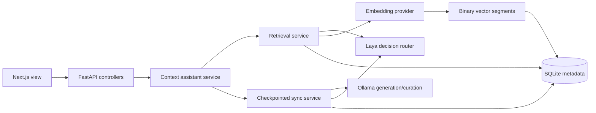
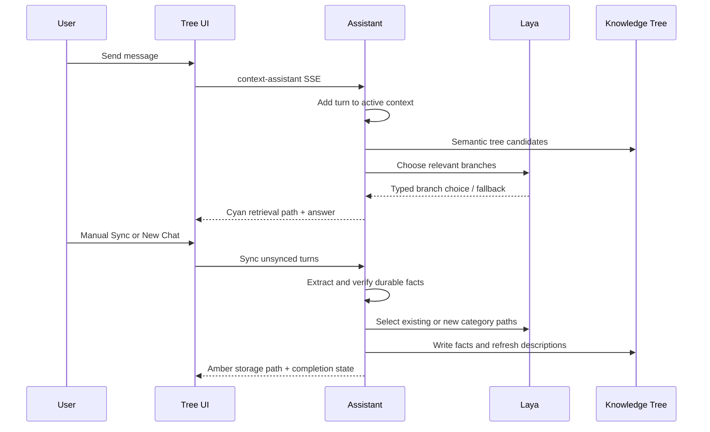
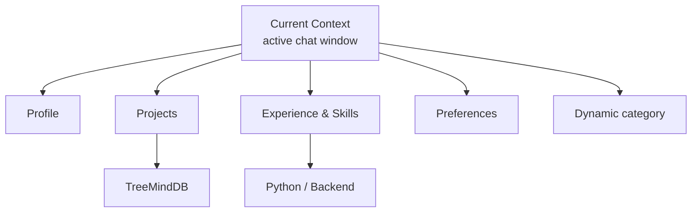

# TreeMindDB

TreeMindDB is a localhost-first personal assistant with an inspectable, hierarchical vector-memory tree. It keeps the active chat context separate from durable knowledge, uses Laya to choose relevant tree branches, and shows retrieval and synchronization paths in the UI.

## Run locally

```bash
cd /home/vrajpatel/personal/TreeMind
python3 -m venv .venv
.venv/bin/pip install -e './backend[test]'
ollama pull llama3.2:3b
ollama pull nomic-embed-text
./scripts/start-backend.sh
```

In another terminal:

```bash
cd /home/vrajpatel/personal/TreeMind/frontend
npm install
npm run dev
```

Open `http://localhost:3000`. Configure the local models in `.env`:

```dotenv
OLLAMA_BASE_URL=http://localhost:11434
OLLAMA_MODEL=llama3.2:3b
OLLAMA_EMBEDDING_MODEL=nomic-embed-text
CONTEXT_WINDOW_TOKENS=100000
CONTEXT_RETAIN_TOKENS=10000
```

## How it works

TreeMindDB has two complementary memory layers:

| Layer | Purpose | Retention |
| --- | --- | --- |
| Active context | The current conversation’s working memory, used for recent details and immediate replies. | Up to the configured context window. |
| Personal knowledge tree | Durable, structured descriptions and atomic facts grouped into meaningful categories. | Persistent SQLite metadata plus local vectors. |

Normal messages are added to active context and answered from active context plus a Laya-guided tree search. Durable knowledge is synchronized only when you click **Sync TreeMindDB**, start a **New conversation**, or the context reaches its rollover threshold. Synchronization is incremental: only turns after the previous sync checkpoint are processed.

The tree has one shared **Current Context** root. Its dynamic child branches represent knowledge such as Profile, Projects, Experience & Skills, Preferences, Relationships, and automatically created categories. Every node has a concise description of what it contains, helping Laya make category decisions quickly.

## Architecture



- **View:** side-by-side chat and interactive React Flow tree. Cyan paths show retrieval; amber paths show synchronization/storage.
- **Controllers:** validate API input and stream Server-Sent Events (SSE).
- **Services:** answer questions, manage active context, synchronize incremental chat segments, classify facts, refresh node descriptions, and resolve conflicts.
- **Adapters:** Ollama generation/embeddings, Laya typed-choice routing, SQLite metadata, and append-only float32 vector segments.

## Chat, retrieval, and sync flow



At 90k tokens, TreeMind synchronizes the oldest 80k-token portion, then retains the newest 10k tokens as the active working context. If generation is unavailable or a sync cannot complete, the conversation remains unsynced instead of silently losing information.

## Tree and retrieval design



Laya makes typed branch choices using each node’s label and description; it does not generate vector similarity. If Laya is unavailable, TreeMindDB uses visible semantic-ranking fallback and records the reason in the operation trace.

## Storage model

- SQLite stores collections, conversations, context segments, tree nodes, facts, memberships, traces, and synchronization checkpoints.
- Binary vector segments store normalized embeddings; SQLite stores offsets and model/dimension identity.
- Durable facts are compact structured summaries, not a duplicate raw chat archive. Node descriptions are regenerated from their current facts.
- Conflicting facts become pending updates; the owner chooses whether to replace or retain the current value.

## Diagnostics

- `GET /api/v1/health` — server and embedding state.
- `GET /api/v1/models/status` — Ollama/Laya readiness and embedding mode.
- `GET /api/v1/traces` — persisted operation traces.
- `GET /api/v1/conversations/{id}/sync-status` — synchronization checkpoint state.

Enable **Verbose mode** in the UI to inspect the actual Laya branch choices, fallback reason, retrieval candidates, and synchronization events.

## Tests

```bash
cd /home/vrajpatel/personal/TreeMind/backend
PYTHONPATH=. ../.venv/bin/pytest -q

cd ../frontend
npm run build
```
