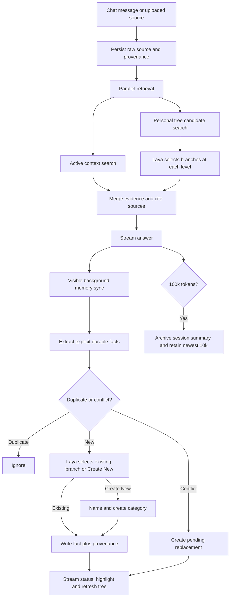

# TreeMindDB architecture

TreeMind separates controllers, domain services, persistence adapters, and the Next.js view. The chat controller coordinates work; it does not decide facts or access SQLite directly. The persistent personal tree is separate from each conversation's transient 100k-token context window.

## Retrieval and insertion

- Every question searches active context and the persistent tree in parallel. The response includes evidence from both; if they conflict, the assistant exposes the conflict instead of silently replacing a fact.
- Laya receives typed choices for actual sibling branches plus an explicit `Create new category` option. It never supplies vector similarity or invents a fact. If Laya fails, semantic branch ranking is used and the reason is stored in the trace and displayed in verbose mode.
- The local chat model extracts only explicit durable facts from untrusted source content. Atomic facts retain their source document ID and excerpt, so a node inspection shows where information came from.
- Chat replies are delivered before the extraction/indexing phase finishes. The same SSE connection then reports source save, extraction, Laya storage routes, branch creation, conflicts, fact writes, and completion.

## Model configuration and recovery

`OLLAMA_MODEL` is the generation model. `OLLAMA_EMBEDDING_MODEL` must be a dedicated semantic embedding model such as `nomic-embed-text`; its identity and dimension are stored with the collection. TreeMind reports an unavailable embedding service as degraded rather than silently calling its vectors semantic.

Do not mix vectors from different embedding models or dimensions. Rebuild/re-embed a collection from its retained sources before changing its embedding model. Laya remains optional at runtime: semantic fallback is deliberately visible in the API trace and UI.
